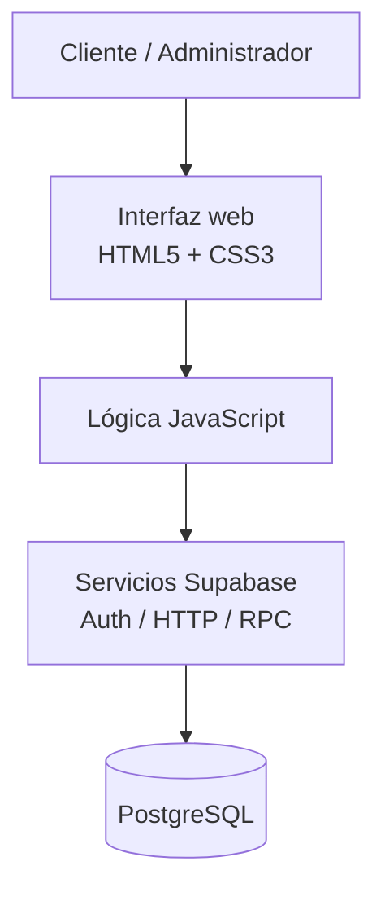
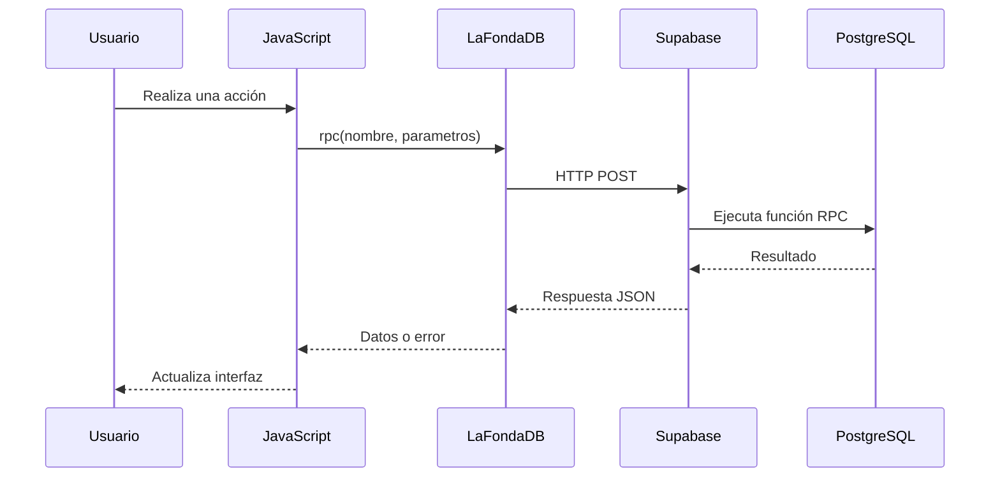

# Arquitectura técnica — La Fonda Web

## 1. Descripción general

La Fonda Web es una plataforma digital orientada a la atención de clientes y a determinadas operaciones administrativas del restaurante.

El sistema permite consultar la carta digital, gestionar cuentas, realizar pedidos, consultar su historial y acceder a funcionalidades como reservas y reseñas.

La aplicación está desarrollada con HTML5, CSS3 y JavaScript nativo. Para acceder a la información utiliza servicios de Supabase, funciones RPC y PostgreSQL.

La plataforma web y el sistema de escritorio son aplicaciones independientes que comparten una base de datos centralizada.

## 2. Tecnologías utilizadas

| Tecnología | Responsabilidad |
|---|---|
| HTML5 | Estructura de las páginas |
| CSS3 | Estilos y diseño adaptable |
| JavaScript | Interacción y lógica del cliente |
| Supabase Auth | Verificación y servicios de autenticación |
| HTTP / RPC | Comunicación con funciones de base de datos |
| PostgreSQL | Persistencia de información |
| Git y GitHub | Control de versiones y colaboración |

## 3. Arquitectura general

La arquitectura web separa la presentación visual, el comportamiento del cliente y las operaciones de acceso a datos.



**Interpretación:** las acciones del usuario se procesan mediante JavaScript, que puede comunicarse con Supabase para consultar o modificar información según las funcionalidades implementadas.

## 4. Organización técnica

```text
restaurante-web/
├── componentes/
│   ├── navbar/
│   └── footer/
├── css/
├── imagenes/
├── js/
│   ├── auth.js
│   ├── auth-email.js
│   ├── cargar-componentes.js
│   ├── config.js
│   ├── db.js
│   ├── sesion.js
│   ├── stock.js
│   └── transiciones.js
├── paginas/
│   ├── acceso/
│   ├── administrador/
│   ├── contacto/
│   ├── menu/
│   ├── nosotros/
│   ├── pagos/
│   ├── pedidos/
│   ├── perfil/
│   ├── resenas/
│   └── reservas/
├── docs/
├── index.html
├── inicio.css
└── README.md
```

## 5. Componentes principales

| Componente | Responsabilidad |
|---|---|
| `index.html` | Punto de entrada del sitio web |
| `componentes/navbar/` | Navegación compartida |
| `componentes/footer/` | Pie de página compartido |
| `js/cargar-componentes.js` | Inserción de componentes HTML |
| `js/db.js` | Solicitudes RPC a Supabase |
| `js/auth.js` | Operaciones de autenticación |
| `js/auth-email.js` | Envío y verificación de códigos OTP |
| `js/transiciones.js` | Comportamiento de transiciones |
| `paginas/` | Organización de secciones funcionales |

## 6. Comunicación con Supabase

La aplicación utiliza `js/config.js` para obtener la configuración de conexión y `js/db.js` para realizar solicitudes HTTP.

En el archivo `db.js`, la función `rpc()` construye una solicitud POST hacia:

`/rest/v1/rpc/{nombre_funcion}`

Los parámetros se envían en formato JSON y las respuestas son procesadas por JavaScript.



## 7. Decisiones de diseño

| Decisión | Beneficio esperado |
|---|---|
| Separar HTML, CSS y JavaScript | Facilita el mantenimiento |
| Organizar páginas por funcionalidad | Mejora la localización del código |
| Reutilizar navbar y footer | Favorece la consistencia visual |
| Centralizar llamadas RPC en `db.js` | Reduce duplicación de solicitudes |
| Mantener repositorios independientes | Permite actualizar cada aplicación por separado |

## 8. Consideraciones técnicas

La comunicación entre la web y PostgreSQL depende de la configuración, permisos y funciones implementadas en Supabase.

Las verificaciones visuales del navegador no sustituyen los controles de seguridad del servidor o de la base de datos.

La arquitectura documentada representa el código revisado. No implica que todas las funciones hayan superado pruebas de integración o seguridad.

## 9. Relación con otros documentos

- [Interfaces web](INTERFACES.md)
- [Flujo de pedidos](FLUJO_PEDIDOS.md)
- [Autenticación](AUTENTICACION.md)
- [Integración](INTEGRACION.md)
