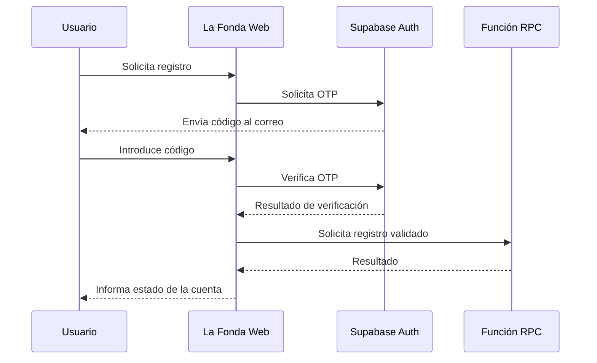

# Autenticación y gestión de sesiones — La Fonda Web

## 1. Objetivo

Documentar los mecanismos utilizados para identificar usuarios, verificar correos electrónicos, gestionar sesiones y recuperar el acceso a las cuentas.

## 2. Componentes principales

| Archivo | Responsabilidad |
|---|---|
| `js/auth.js` | Inicio de sesión, registro y operaciones de cuenta |
| `js/auth-email.js` | Solicitudes para enviar y verificar códigos OTP |
| `js/sesion.js` | Funcionalidades relacionadas con la sesión |
| `js/db.js` | Comunicación con funciones RPC |
| `js/config.js` | Configuración de Supabase |

## 3. Funcionalidades documentadas

La aplicación incorpora lógica para:

- Registrar cuentas de clientes.
- Iniciar y cerrar sesión.
- Verificar direcciones de correo.
- Restablecer contraseñas mediante verificación.
- Diferenciar usuarios clientes y administradores.

## 4. Verificación mediante correo electrónico

El archivo `auth-email.js` realiza solicitudes a los servicios de autenticación de Supabase.

Se identifican dos operaciones principales:

| Operación | Endpoint |
|---|---|
| Enviar código | `/auth/v1/otp` |
| Verificar código | `/auth/v1/verify` |

El código revisado valida un OTP numérico de seis dígitos antes de enviarlo al servicio de verificación.

## 5. Flujo de verificación

## 6. Funciones RPC identificadas

En `js/auth.js` aparecen llamadas a:

| Función | Finalidad |
|---|---|
| `web_login` | Inicio de sesión |
| `web_registrar_cliente_validado` | Registro de cliente |
| `web_confirmar_registro_cliente` | Confirmación de registro verificado |
| `web_restablecer_contrasena_cliente` | Restablecimiento de contraseña |

La seguridad de estas operaciones depende también de las validaciones y autorizaciones implementadas en PostgreSQL.

## 7. Gestión de sesión

El archivo `auth.js` utiliza almacenamiento del navegador para conservar información relacionada con la sesión.

Se identifican las claves:

- `lafonda_web_session` en `sessionStorage`.
- `la_fonda_user` en `localStorage`.

También se implementan operaciones para consultar, actualizar y limpiar la información de sesión.

## 8. Consideraciones de seguridad

Durante la revisión del código se identificó que `auth.js` conserva la contraseña del usuario dentro del objeto de sesión.

Esto representa un riesgo de seguridad y debe corregirse.

### Mejoras recomendadas

1. Evitar almacenar contraseñas en `sessionStorage` o `localStorage`.
2. Utilizar mecanismos de sesión y tokens apropiados.
3. Validar permisos en el servidor o base de datos.
4. Controlar intentos de autenticación.
5. Revisar políticas de acceso y funciones RPC.
6. Ejecutar pruebas de seguridad.

**Estado:** estas son recomendaciones pendientes de validación o implementación, no medidas que se consideren concluidas.

## 9. Pruebas recomendadas

| Caso | Resultado esperado |
|---|---|
| Correo inválido | Solicitud rechazada |
| OTP incorrecto | Verificación rechazada |
| OTP expirado | Solicitar un nuevo código |
| Usuario sin permisos | Acceso denegado |
| Recuperación no validada | Impedir cambio de contraseña |
| Cierre de sesión | Limpiar los datos correspondientes |

## 10. Conclusión

La plataforma dispone de funciones de autenticación y verificación mediante Supabase. Sin embargo, es necesario fortalecer la protección de credenciales y validar los controles de autorización antes de considerar segura su implementación para producción.
