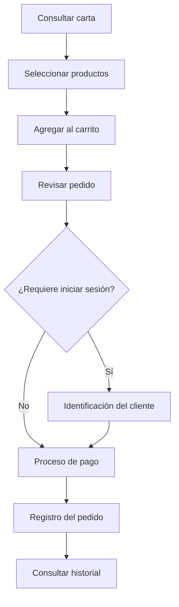

# Flujo de pedidos — La Fonda Web

## 1. Objetivo

Describir el recorrido de un cliente desde la consulta de la carta digital hasta el registro y seguimiento de su pedido.

Este documento presenta el flujo funcional general de la plataforma y los puntos de interacción entre la interfaz y los servicios de datos.

## 2. Etapas del proceso

| Etapa | Descripción |
|---|---|
| Carta digital | El cliente consulta los productos disponibles |
| Carrito | Selecciona productos y cantidades |
| Identificación | Inicia sesión cuando la operación lo requiere |
| Confirmación | Revisa la información de su compra |
| Pago | Utiliza el proceso de pago disponible |
| Registro | La información del pedido se almacena mediante las operaciones correspondientes |
| Historial | El cliente consulta sus pedidos registrados |

## 3. Diagrama de flujo

**Nota:** este diagrama resume el recorrido funcional previsto. La confirmación efectiva de un pago y el registro definitivo dependen de las validaciones y operaciones implementadas.

## 4. Componentes involucrados

| Componente | Responsabilidad |
|---|---|
| `paginas/menu/` | Presentación de la carta |
| `paginas/pedidos/` | Interfaces relacionadas con pedidos |
| `paginas/pagos/` | Interfaces del proceso de pago |
| `js/auth.js` | Identificación y gestión de sesión |
| `js/db.js` | Solicitudes RPC hacia Supabase |
| PostgreSQL | Almacenamiento de información |

## 5. Validaciones importantes

Las operaciones de pedidos deben considerar:

- Cantidades válidas de productos.
- Disponibilidad de artículos.
- Precios vigentes.
- Identificación del cliente cuando corresponda.
- Consistencia de los importes.
- Confirmación de la operación antes del registro definitivo.

Estas validaciones deben verificarse en la implementación real. No basta con aplicarlas solamente en el navegador.

## 6. Relación con el sistema de escritorio

La plataforma web y el sistema de escritorio comparten PostgreSQL como fuente de información.

Esto permite que ambas aplicaciones trabajen con información relacionada con la operación del restaurante.

Sin embargo, la forma en que un pedido web es recibido y procesado por los módulos internos debe verificarse mediante pruebas de integración.

## 7. Casos de prueba propuestos

| Escenario | Resultado esperado |
|---|---|
| Carrito sin productos | No permitir confirmar un pedido vacío |
| Cantidad inválida | Rechazar la operación |
| Producto no disponible | Informar al cliente |
| Sesión requerida e inexistente | Solicitar autenticación |
| Error de comunicación | Mostrar mensaje y evitar confirmaciones falsas |
| Pedido registrado | Permitir consultar la información correspondiente |

Estos son escenarios recomendados; no constituyen evidencia de pruebas ejecutadas.

## 8. Conclusión

El flujo de pedidos conecta varias interfaces de La Fonda Web y depende tanto de la interacción del cliente como de la correcta ejecución de las operaciones de datos.
