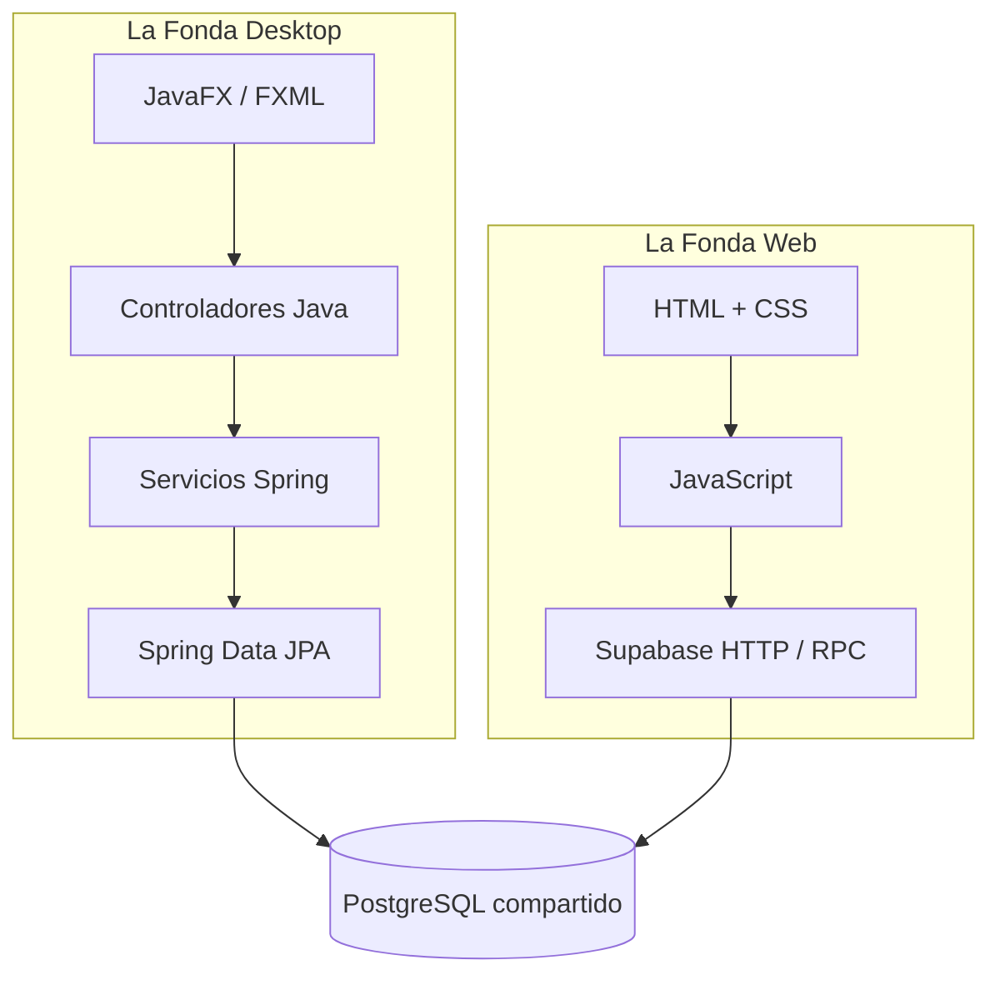
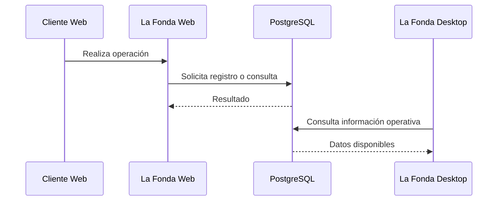

# Integración de sistemas — La Fonda

## 1. Descripción general

La Fonda está conformada por dos aplicaciones complementarias:

- **La Fonda Desktop:** sistema de escritorio destinado a operaciones internas.
- **La Fonda Web:** plataforma orientada a clientes y determinadas tareas administrativas.

Ambas utilizan PostgreSQL alojado en Supabase para gestionar información relacionada con el restaurante.

## 2. Arquitectura de integración

## 3. Tecnologías de integración

| Aplicación | Mecanismo de acceso |
|---|---|
| Escritorio | Spring Data JPA / JDBC |
| Web | Solicitudes HTTP y funciones RPC |
| Datos compartidos | PostgreSQL |
| Servicios web | Supabase |

## 4. Responsabilidades de cada aplicación

| Área | Aplicación |
|---|---|
| Gestión de mesas | Escritorio |
| Operaciones de cocina | Escritorio |
| Caja e inventario | Escritorio |
| Carta digital | Web |
| Registro de clientes | Web |
| Pedidos de clientes | Web |
| Reservas digitales | Web |
| Administración de contenido web | Web |

La distribución de funciones evita que ambas interfaces tengan que ofrecer exactamente las mismas operaciones.

## 5. Acceso a los datos

### 5.1. Sistema de escritorio

El sistema utiliza servicios Java y repositorios de Spring Data JPA para realizar operaciones sobre PostgreSQL.

Su organización incluye:

- Controladores.
- Servicios.
- Entidades.
- Repositorios.
- Configuración de persistencia.

### 5.2. Plataforma web

La plataforma utiliza JavaScript para enviar solicitudes HTTP a Supabase.

El archivo `js/db.js` implementa una función común para ejecutar solicitudes RPC y procesar sus resultados.

## 6. Ejemplo conceptual de intercambio de información

Este ejemplo representa el mecanismo de intercambio a través de la base de datos. No implica que todas las operaciones se sincronicen automáticamente ni que exista comunicación directa entre los programas.

## 7. Ventajas de la integración

| Característica | Beneficio |
|---|---|
| Información centralizada | Reduce la necesidad de registros separados |
| Aplicaciones independientes | Facilita mantener cada interfaz |
| Tecnologías especializadas | Cada entorno utiliza herramientas adecuadas |
| Base de datos común | Permite compartir información operativa |
| Repositorios separados | Favorece el desarrollo y control de versiones |

## 8. Riesgos y consideraciones

La integración requiere prestar atención a:

- Compatibilidad del esquema de base de datos.
- Permisos de acceso.
- Integridad de las operaciones.
- Cambios en funciones RPC.
- Concurrencia de operaciones.
- Validación del estado de los pedidos.
- Tratamiento de errores de comunicación.

Los cambios de estructura de datos deben evaluarse para evitar incompatibilidades entre aplicaciones.

## 9. Pruebas de integración recomendadas

| Prueba | Resultado esperado |
|---|---|
| Modificar un producto | Confirmar la actualización donde corresponda |
| Registrar un pedido web | Verificar su persistencia |
| Consultar pedido desde escritorio | Comprobar la información disponible |
| Actualizar disponibilidad | Verificar consistencia entre aplicaciones |
| Simular error de conexión | Controlar el error sin pérdida indebida de información |

Los resultados deben documentarse después de ejecutar las pruebas.

## 10. Conclusión

La integración de La Fonda se basa en aplicaciones independientes que comparten una fuente de información común. Esta estrategia permite diferenciar las operaciones internas de los servicios digitales, aunque requiere controles de consistencia, seguridad y pruebas entre sistemas.
