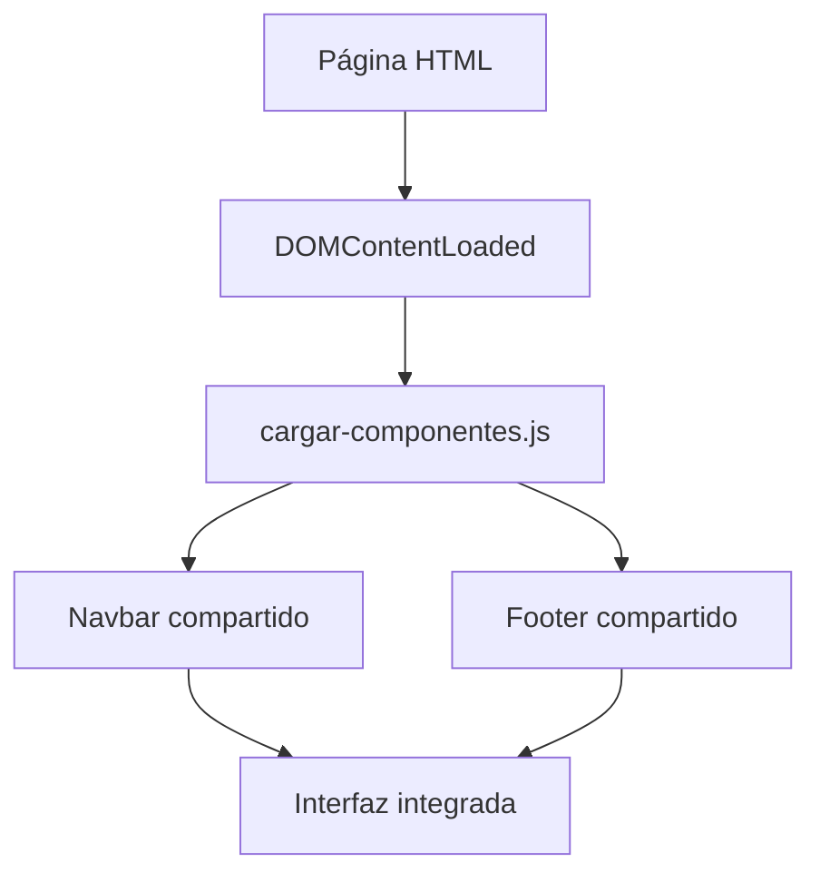

# Implementación de interfaces web — La Fonda

## 1. Objetivo

La interfaz web de La Fonda permite a clientes y administradores interactuar con las funcionalidades digitales del restaurante.

Su implementación utiliza HTML5, CSS3 y JavaScript, manteniendo una separación entre estructura, presentación e interacción.

## 2. Tecnologías de interfaz

| Tecnología | Aplicación |
|---|---|
| HTML5 | Formularios, navegación y contenido |
| CSS3 | Diseño visual y adaptación de pantallas |
| JavaScript | Eventos, validaciones e interacciones |
| Fetch API | Carga de recursos y solicitudes HTTP |

## 3. Organización de interfaces

| Sección | Finalidad |
|---|---|
| Inicio | Presentación del restaurante |
| Carta | Consulta de productos |
| Acceso | Registro e inicio de sesión |
| Pedidos | Gestión de pedidos del cliente |
| Pagos | Proceso de pago |
| Perfil | Información del usuario |
| Reservas | Gestión de solicitudes de reserva |
| Reseñas | Interacción y opiniones |
| Administración | Funcionalidades de gestión |

## 4. Componentes reutilizables

La Fonda dispone de componentes compartidos para mantener una presentación consistente entre páginas.

Entre ellos destacan:

- Barra de navegación (`navbar`).
- Pie de página (`footer`).
- Lógica de carga mediante `cargar-componentes.js`.

### 4.1. Carga de componentes

El archivo `js/cargar-componentes.js` escucha el evento `DOMContentLoaded` y solicita los recursos HTML de navegación y pie de página.

Posteriormente, inserta su contenido en los contenedores correspondientes.

### 4.2. Beneficios

| Característica | Beneficio |
|---|---|
| Reutilización | Evita repetir componentes en cada página |
| Consistencia visual | Mantiene navegación y pie de página uniformes |
| Mantenimiento | Facilita actualizar elementos compartidos |
| Organización | Separa recursos comunes de páginas funcionales |

## 5. Ejemplo: carta digital

La carta digital presenta los productos del restaurante y permite la interacción del cliente con las opciones disponibles.

En su implementación intervienen distintos elementos:

| Elemento | Función |
|---|---|
| HTML | Estructura de productos |
| CSS | Presentación y distribución visual |
| JavaScript | Interacciones del usuario |
| Supabase | Consulta de datos cuando corresponde |

## 6. Experiencia de usuario

El diseño busca facilitar la navegación y permitir el acceso a funciones como la carta, pedidos, reservas y cuenta personal.

Entre los aspectos importantes se encuentran:

- Claridad de la navegación.
- Organización del contenido.
- Consistencia de los elementos visuales.
- Mensajes de validación.
- Adaptación a distintos tamaños de pantalla.

## 7. Evidencias recomendadas

Para complementar esta documentación se recomienda incorporar capturas reales de:

1. Página principal.
2. Carta digital.
3. Carrito de compras.
4. Formulario de inicio de sesión.
5. Panel administrativo.

Las capturas deben corresponder a la versión actual del sistema y permitir identificar las funcionalidades implementadas.

## 8. Conclusión

La organización de las interfaces mediante recursos independientes y componentes compartidos facilita la evolución de la plataforma y favorece una experiencia visual consistente.
